# Field trial maps and disease assessments: from spreadsheets to analysis-ready tables

<div align="justify">

Field experiments are often recorded in spreadsheets drawn for people, not for analysis: a field map
(croqui) where each cell or merged range is a plot, coloured by block, and disease ratings typed in separate
sheets, one per date or per trial, or marked directly on copies of the map. This Python package
(`field_design_extraction`) reads those workbooks as they are and turns them into two kinds of tables:

- **design** — one row per plot: `plot_key`, `block_id`, `block_label`, `plot_number`, `row`, `column`
  (`row`/`column` are the plot's cell on the map);
- **ratings** — one file per assessment date, only the rated plots: `plot_key`, `block_id`, `plot_number`,
  `date`, `disease` and the value columns you choose (e.g. `score`).

The two join on `plot_key` (`block:plot_number:row:column`; the position keeps it unique when a plot number
occurs twice). Along the way it checks the data (plots claimed by two blocks, ratings that match no plot or
more than one, plots rated twice) and can draw the field layout, the plots assessed and the ratings of each
date, and the distribution of scores over time.

## Install

In the Python environment that will run your scripts (Python 3.10 or newer; matplotlib for the figures):

```
git clone https://github.com/mhdf/field_design_extraction.git
pip install -e field_design_extraction
```

`-e` (editable) makes changes to the package code take effect without reinstalling.

## Quick start

A workbook `trial.xlsx` with two sheets:

- `map` — the field map: plot numbers in cells B3:K8, block 1 in columns B–F, block 2 in columns G–K;
- `ratings` — one row per rated plot, with the columns `plot`, `block` (`1` or `2`) and `score`.

```python
from pathlib import Path

import field_design_extraction as fde

layouts = {
    "trial": {
        "workbook": Path("trial.xlsx"),
        "sheet": "map",
        "region": "B3:K8",
        "output_folder": Path("consolidated"),
        "blocks": [
            {"block_id": "B1", "label": "Block 1", "regions": ["B3:F8"]},
            {"block_id": "B2", "label": "Block 2", "regions": ["G3:K8"]},
        ],
    },
}

rating_sources = {
    "trial_score": {
        "layout_id": "trial",
        "disease": "leaf_spot",
        "workbook": Path("trial.xlsx"),
        "plot_column": "plot",
        "block_column": "block",
        "block_mapping": {"1": "B1", "2": "B2"},
        "value_columns": {"score": "score"},
        "assessments": {"first": {"sheet": "ratings", "date": "2025-09-01"}},
    },
}

designs, ratings = fde.run(layouts, rating_sources)          # tables in consolidated/
fde.save_figures(layouts, rating_sources, designs, ratings)  # optional: consolidated/figures/
```

This writes `consolidated/trial.csv` (one row per plot) and `consolidated/trial_score_20250901.csv` (the
ratings, linked to the plots), and prints what it found. The sections below explain each setting; the
[examples](#examples) show complete scripts with figures.

## Use

Your workbook stays as it is: the package reads it (it never changes it) and writes its tables and figures to
a separate output folder. What tells the package how to read *your* file are the settings in your script —
the sheet with the field map, the cells holding each block's plots, the sheets with the ratings, the row with
the column names, the columns with the plot number, the block and the values. Nothing in the code is tied to
one layout: another workbook, organised differently, needs only other settings.

A project script holds those settings in two dictionaries, `layouts` (field maps) and `rating_sources`
(ratings), and runs the steps:

```python
import field_design_extraction as fde

designs = fde.build_designs(layouts)                    # map → design tables
ratings = fde.build_ratings(rating_sources, designs)    # ratings linked to plots
fde.export(layouts, rating_sources, designs, ratings)   # CSV files
```

Each step prints what it found: plots per block, plot numbers repeated within a block, and per date how many
ratings were linked and why the others were not. `fde.plot_sheet(workbook, sheet, region)` draws a sheet as it
looks in Excel, to check the cells you put in the settings.

## Examples

Two synthetic workbooks in `examples/data/` stand in for field files typed by hand. They are made by
`examples/create_example_workbooks.py` (fixed random seed): field maps with numbered plots in coloured blocks,
and ratings from 0 to 100 that form patches across the field, as disease often does. Each example script
follows the three steps of a real project: look at the input workbook, describe it in the settings, run.

```
python examples/create_example_workbooks.py        # writes examples/data/*.xlsx
python examples/example_1_merged_plots.py          # writes examples/output/example_1/
python examples/example_2_one_sheet_per_trial.py   # writes examples/output/example_2/
```

### Example 1 — plots in merged cells, one ratings sheet per date

**1. The input workbook.** Sheet `field_map` holds the field map: four coloured blocks, each plot number in two
merged cells. Sheets `date_1` and `date_2` hold the ratings of each assessment date, one row per rated plot;
on date 2 the plots of date 1 were assessed again, together with new ones.

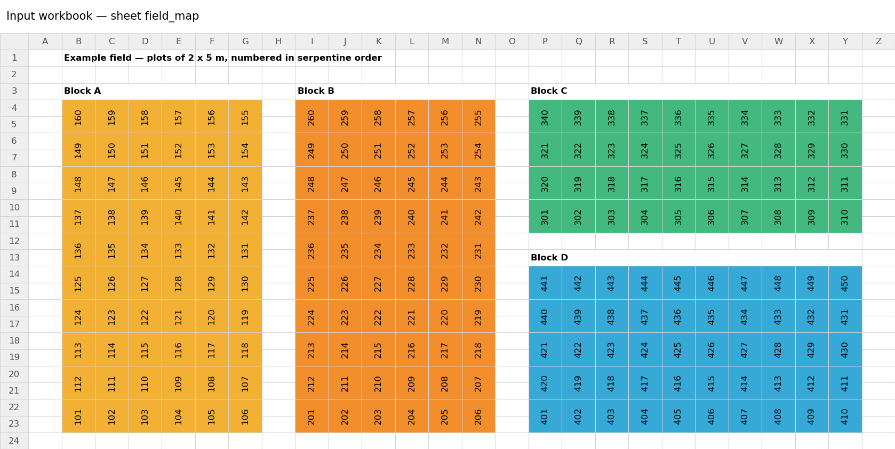 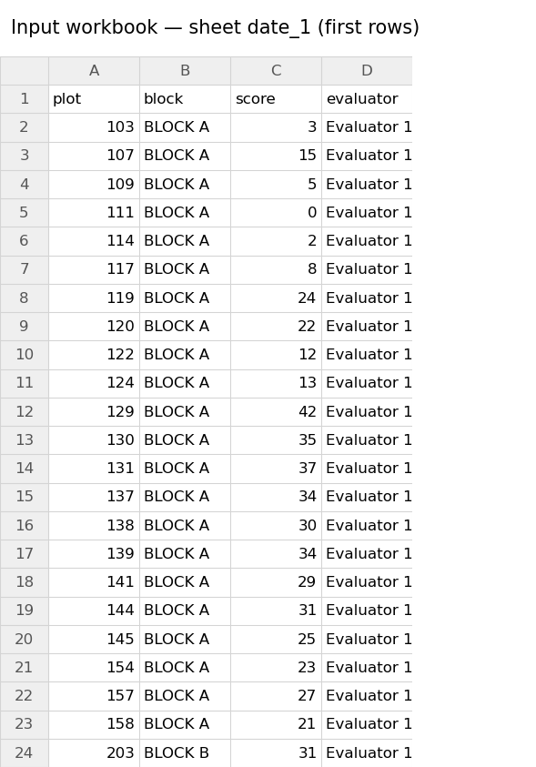

**2. The settings describe that workbook** (`examples/example_1_merged_plots.py`):

| In the workbook | In the settings |
|---|---|
| field map on sheet `field_map`, cells B3:Y23 | `"sheet": "field_map"`, `"region": "B3:Y23"` |
| Block A: plots in columns B–G, rows 4–23 (and so on for B, C, D) | `{"block_id": "BLOCK_A", "regions": ["B4:G23"]}` |
| each plot number in the top cell of two merged cells | `"unit_rules": {"merged": True, "anchor": True}` |
| one ratings sheet per date: `date_1`, `date_2` | `"assessments": {"first": {"sheet": "date_1", "date": "Date 1"}, ...}` |
| column names on row 1: `plot`, `block`, `score`, `evaluator` | `"plot_column": "plot"`, `"block_column": "block"`, `"value_columns": {...}` |
| blocks written `BLOCK A` in the ratings | `"block_mapping": {"BLOCK A": "BLOCK_A", ...}` |

**3. The result.** A design table with one row per plot, and one ratings table per date:

| plot_key | block_id | block_label | plot_number | row | column |
|---|---|---|---|---|---|
| BLOCK_A:160:4:2 | BLOCK_A | Block A | 160 | 4 | 2 |
| BLOCK_A:159:4:3 | BLOCK_A | Block A | 159 | 4 | 3 |

| plot_key | block_id | plot_number | date | disease | score | evaluator |
|---|---|---|---|---|---|---|
| BLOCK_A:103:22:4 | BLOCK_A | 103 | Date 2 | leaf_spot | 24 | Evaluator 1 |
| BLOCK_A:104:22:5 | BLOCK_A | 104 | Date 2 | leaf_spot | 29 | Evaluator 1 |

And the figures — experimental design:

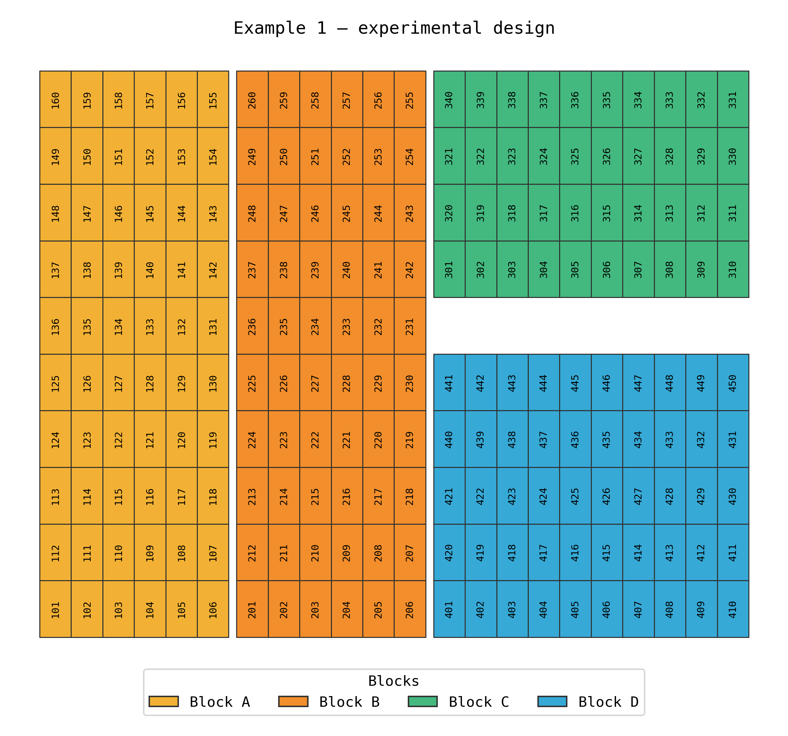

Plots assessed on each date (black):

 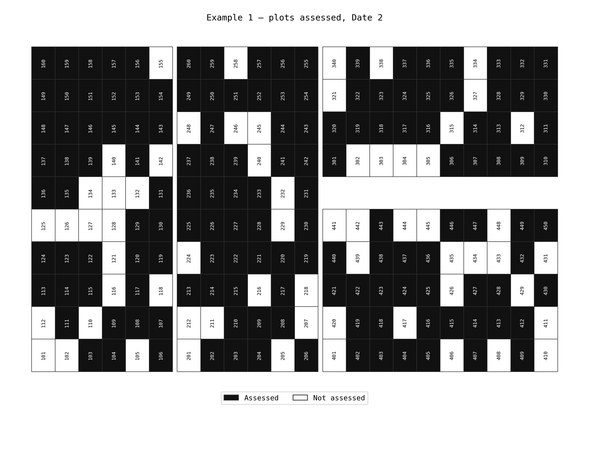

Disease score of each plot on each date (grey: not assessed on that date):

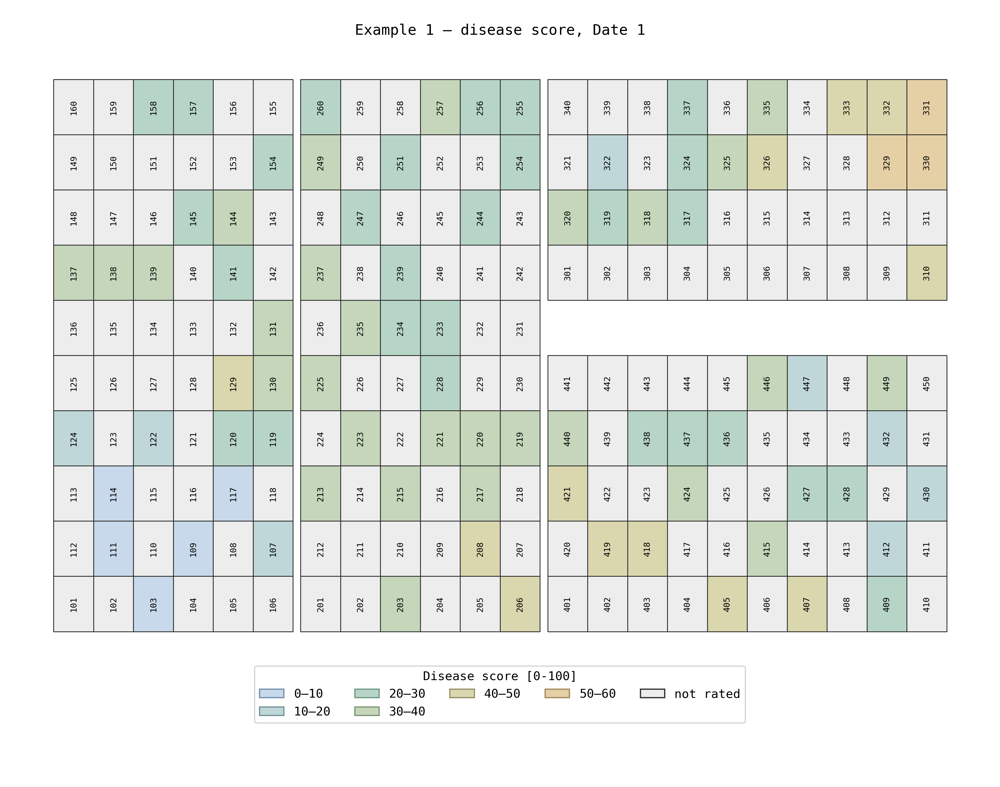 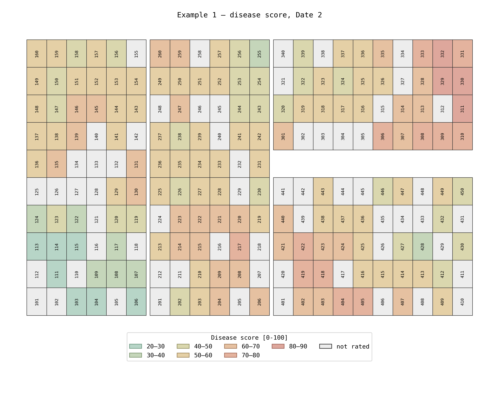

Share of the assessed plots in each score class, per date (numbers inside the bars: plots):

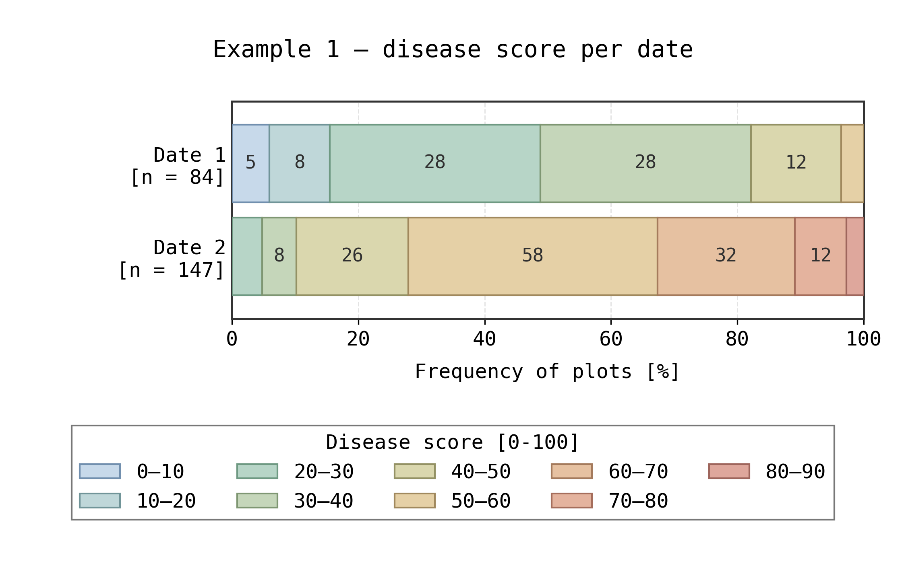

### Example 2 — one cell per plot, one ratings sheet per trial

**1. The input workbook.** Sheet `field_map` holds four trials side by side, plots numbered from 1 in each
trial, with two notes on row 2 (site, cultivar). Each trial has its own ratings sheet (`Trial_1` … `Trial_4`),
with notes on the first rows (date, growth stage, assessed area), the column names on row 7, and MIN/MAX
formulas below the table.

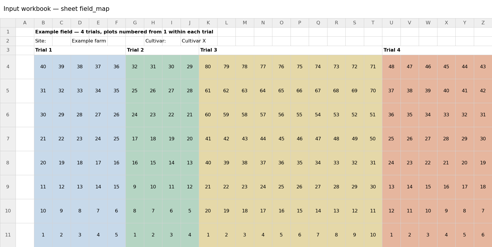 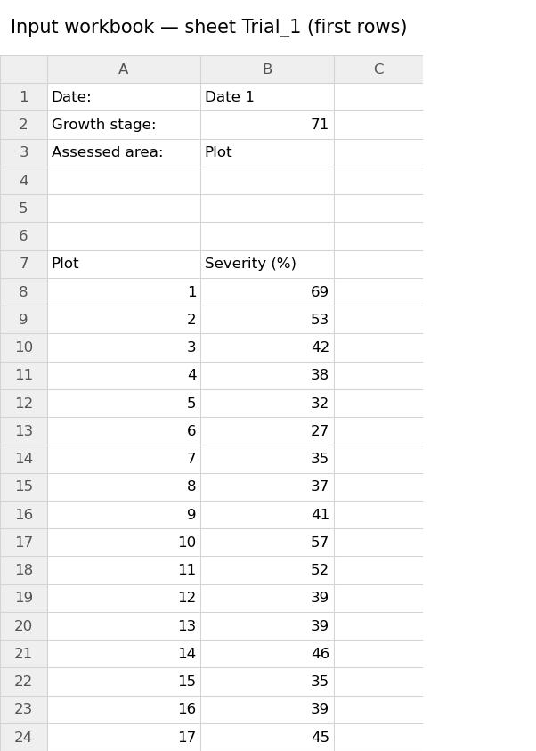

**2. The settings describe that workbook** (`examples/example_2_one_sheet_per_trial.py`):

| In the workbook | In the settings |
|---|---|
| field map on sheet `field_map`, cells B3:Z11 | `"sheet": "field_map"`, `"region": "B3:Z11"` |
| Trial 1: plots in B4:F11 (and so on for trials 2–4) | `{"block_id": "TRIAL_1", "regions": ["B4:F11"]}` |
| one plot number per cell | `"unit_rules": {"value_types": ["numeric"], "merged": False}` |
| one ratings sheet per trial, no block column | `"block_column": None`, `"assessments": {"TRIAL_1": {"sheet": "Trial_1", "block": "TRIAL_1", ...}, ...}` |
| notes on rows 1–3, column names on row 7 | `"header_row": 7` |
| columns `Plot` and `Severity (%)` | `"plot_column": "Plot"`, `"value_columns": {"Severity (%)": "severity"}` |
| MIN/MAX rows below the table (no plot number) | nothing to set: rows without a plot number are dropped |
| notes on the map: "Site: Example farm", "Cultivar: Cultivar X" | layout `"sheet_values": {"site": "Site:", "cultivar": "Cultivar:"}` |
| notes above each ratings table: "Growth stage: 71", "Assessed area: Plot" | ratings `"sheet_values": {"growth_stage": "Growth stage:", "assessed_area": "Assessed area:"}` |

**3. The result** — design and ratings tables (first rows) and figures; the notes became columns:

| plot_key | block_id | block_label | plot_number | row | column | site | cultivar |
|---|---|---|---|---|---|---|---|
| TRIAL_1:40:4:2 | TRIAL_1 | Trial 1 | 40 | 4 | 2 | Example farm | Cultivar X |
| TRIAL_1:39:4:3 | TRIAL_1 | Trial 1 | 39 | 4 | 3 | Example farm | Cultivar X |

| plot_key | block_id | plot_number | date | disease | severity | growth_stage | assessed_area |
|---|---|---|---|---|---|---|---|
| TRIAL_1:1:11:2 | TRIAL_1 | 1 | Date 1 | leaf_blotch | 69 | 71 | Plot |
| TRIAL_1:2:11:3 | TRIAL_1 | 2 | Date 1 | leaf_blotch | 53 | 71 | Plot |

Experimental design:

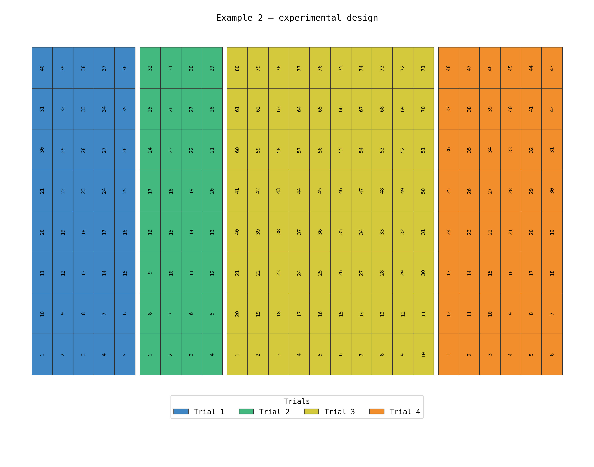

Disease severity of each plot:

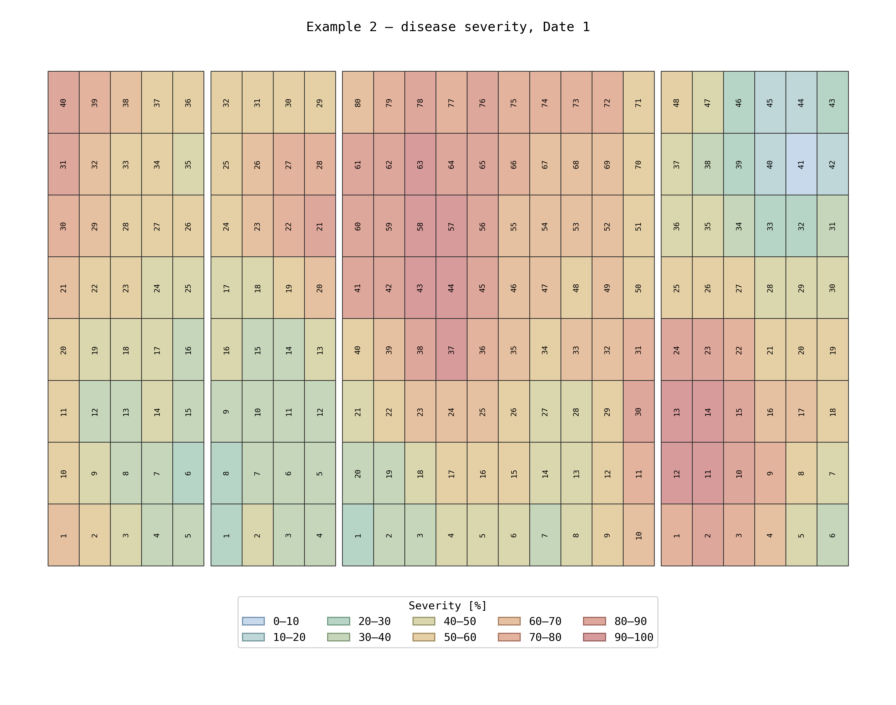

Share of the plots in each severity class (numbers inside the bar: plots):

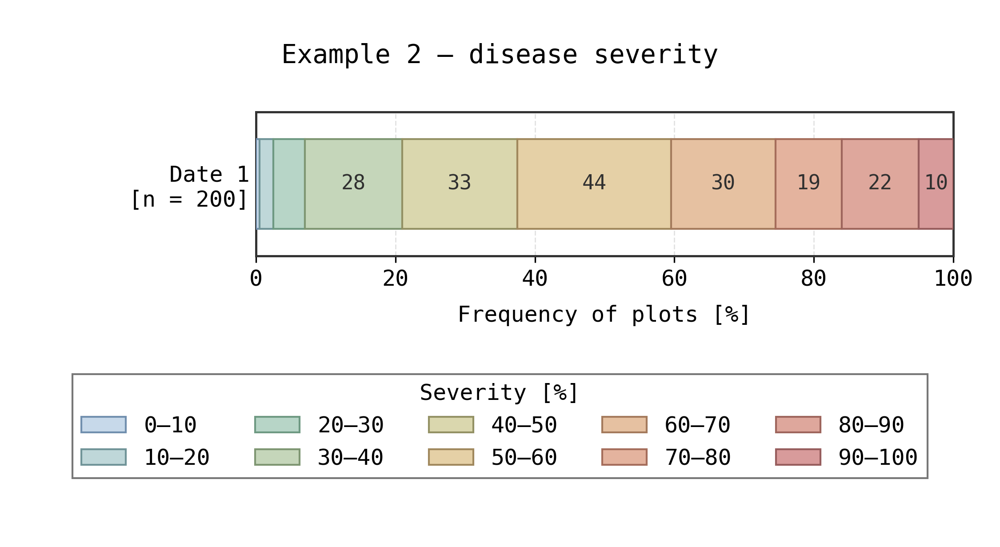

## Settings

### layouts — one entry per field map

| key | meaning |
|---|---|
| `workbook`, `sheet` | the map |
| `region` | Excel range holding the map, e.g. `"B2:AR11"` |
| `output_folder` | where the CSV files go (e.g. `dados/avaliacao_visual/consolidated`) |
| `blocks` | list of `{block_id, label, regions}`; `regions` are the Excel ranges of the block's plots |
| `unit_rules` | which cells count as plots (optional, also per block): `value_types`, `merged` (True/False/None), `anchor` (True: top-left cell of a merged range) |
| `sheet_values` | notes written on the map sheet outside the plots (site, cultivar, planting date…), each becoming a column of the design table — see [Notes outside the tables](#notes-outside-the-tables-sheet_values) |

A cell inside two blocks stops the run with the list of cells. Formula cells are read through the value Excel
saved. Block `attributes` (e.g. `{"treatment": "A"}`) also become design columns.

### rating_sources — one entry per ratings workbook

| key | meaning |
|---|---|
| `layout_id` | the layout the ratings belong to |
| `disease`, `workbook` | |
| `assessments` | `{name: {sheet, date}}`; add `block` when each sheet holds one block. `date`: a date (`2025-09-01`, `01/09/2025`) or a label such as `"Date 1"` (file names then use `date_1`) |
| `header_row` | Excel row with the column names (default 1) |
| `plot_column` | column with the plot number |
| `block_column` | column with the block label; `None` when each sheet holds one block |
| `block_mapping` | block label in the ratings → `block_id` (optional when they are equal) |
| `value_columns` | columns to keep: `{name in the sheet: name in the output}` |
| `sheet_values` | notes written on each ratings sheet outside the table (growth stage, application date…), each becoming a column of the ratings; also per assessment |

Only the columns named here are kept: the plot and block columns, and the `value_columns` (in that order, under
their output names); any other column of the sheet is left out — to keep it, add it to `value_columns`. A
named column missing from a sheet stops the run with the list of columns found. The lines above `header_row`
are not part of the table; to keep a note written there, use `sheet_values`. Rows without a plot number (e.g.
MIN/MAX rows) are dropped; columns holding only whole numbers stay whole (69, not 69.0). Ratings that cannot
be linked go to `<source>_<date>_unlinked.csv` with the reason (`link_status`) and the kept columns.

### Notes outside the tables (`sheet_values`)

Workbooks often carry information that is not part of any table: a note typed next to its label, such as
"Site: Castro", "Cultivar: Imperatriz" or "Planting date: 2025-05-21" on a field map, or "Growth stage: 71" above
a ratings table. It holds for everything on that sheet, so each such note can become a column with the same
value on every row: of the design table (notes on the field map) or of the ratings (notes on a ratings sheet).

For example, in [Example 2](#example-2--one-cell-per-plot-one-ratings-sheet-per-trial) the field map has
"Site:" in B2 with "Example farm" two cells to its right, and each ratings sheet has "Growth stage:" in A2
with 71 next to it:

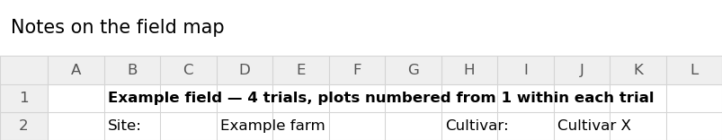 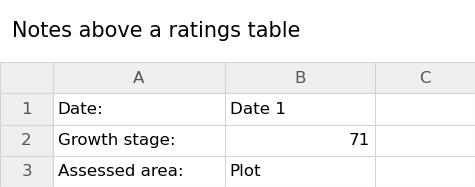

The settings name the new columns and say where each value is:

```python
layouts = {"example_2_design": {..., "sheet_values": {"site": "Site:", "cultivar": "Cultivar:"}}}
rating_sources = {"example_2_severity": {..., "sheet_values": {"growth_stage": "Growth stage:"}}}
```

so every row of the design table gets `site = Example farm` and `cultivar = Cultivar X`, and every rating from
that sheet gets `growth_stage = 71`. Each entry is `name in the output: where to find the value`:

| where to find it | meaning |
|---|---|
| `"Growth stage:"` | the cell holding this label (any case, colon optional); the value is the first filled cell to its right |
| `{"label": "Growth stage:", "direction": "below"}` | the same, looking `"below"`, `"left"` or `"above"` the label instead (the first filled cell in that direction) |
| `"B2"` | the value of that cell |
| `{..., "sheet": "notes"}` | look on another sheet of the workbook |

In a ratings source, `sheet_values` is read on every assessment sheet; an assessment can add its own or
replace one (`"assessments": {"first": {"sheet": ..., "sheet_values": {...}}}`). Formula cells give the value
Excel saved; dates become `YYYY-MM-DD`. A label that is not found gives an empty value and a warning.

### Ratings marked on the map (`"kind": "map"`)

For maps where each date is a copy of the field map and the rating is written into the plot cell (e.g. an
orchard where every cell is a tree). The design then takes every cell as a plot: `unit_rules`
`{"value_types": None, "include_empty": True, "unit_id": "coordinate"}` (plot_number = cell, e.g. `E18`); block
`attributes` (e.g. `{"treatment": "A"}`) become design columns.

| key | meaning |
|---|---|
| `assessments` | `{name: {sheet, date}}`, one sheet per date |
| `status_rules` | ordered list; the first rule whose conditions all hold gives the status. Conditions: `text` (regular expression, case-insensitive), `fills` (list of fill colors as `read_cells` shows them), `empty` (True/False) |
| `default_status` | status of empty cells no rule covers (default `healthy`); non-empty cells no rule covers get `unknown` and are listed |
| `ignore_text` | text read as empty (e.g. plot labels written in tree cells) |
| `flags` | extra True/False columns from the fill, e.g. `{"new_case": ["FFFFFF00"]}` |

Output: one file per date with every plot: `status`, the flags, and the raw cell `value` and `fill` (and
`sheet_values`, if any).

### Figures (optional)

```python
fde.save_figures(layouts, rating_sources, designs, ratings, which=["design", "distribution", "maps"])
```

| figure | file | what it shows |
|---|---|---|
| `design` | `<layout_id>.png` | schematic of the plots, colored by block (or any design column, e.g. treatment) |
| `distribution` | `<source>_distribution.png` | share of plots per score class or status, one bar per date; the segments show the number of plots (`segment_labels`: `"count"`, `"percent"` or `None`) |
| `maps` | `<source>_<date>_map.png` | the schematic colored by the rating of that date (grey: not rated) |
| `coverage` | `<source>_<date>_coverage.png` | ratings tables: which plots were assessed on that date |
| `incidence` | `<source>_incidence.png` | map ratings: share of plots with a status per date, one line per group (e.g. treatment) |

Files go to `<output_folder>/figures` (or the layout's `figure_folder`). Options: a `"figure"` entry in a layout
(`title`, `color_by`, `colors`, `names`, `legend_title`, `plot_size`, `rotate`, `show_labels`, `label_rotation`,
`gaps`, `gap_rule`, `block_outlines`, `hatch_shared_with` + `hatch_label`) and in a ratings source (`value`,
`title`, `colors`, `legend_title`, `xlabel`, `map_title`, `coverage_title`, `bins`, `segment_labels`,
`group_others`, `incidence`). Scores with many
values (e.g. % severity) are grouped into classes (`bins`, default 10 units); half scores (1.5, 2.5…) are hatched.

`group_others` (ratings source), e.g. `{"keep": ["healthy", "hlb"], "label": "others", "color": "#8C8C8C"}`:
in the figures, every other class becomes one class whose name lists what it contains, e.g.
`others (gummosis, dead, missing)`, or your own text with `"description": "dead, other diseases, etc."`;
the CSV files keep the detailed values.

Proportions: `plot_size` = (width, height) of each plot on the schematic, in any unit (only the ratio matters).
Make plots wider than tall when rows are farther apart than plots within a row, e.g. the real spacing
`(6.5, 2.5)` in metres; `rotate` turns the whole map by 90°.

Size: the design, coverage and map figures of a layout all have the same size and plot shapes (the map is
drawn at a fixed scale, with fixed space for the title and the legend — `legend_height`, in inches); the
distribution chart takes the same width, so the figures line up side by side.

Gaps between blocks: `gaps` = (horizontal, vertical) size; `gap_rule` `"any"` (default) puts a gap wherever
blocks meet (at least 2 neighbouring plots), but the gap crosses the whole figure and may cut other blocks;
`"disjoint"` only separates rows/columns that share no block. `label_rotation`: 0 (horizontal) or 90 (vertical).

### Checking the block ranges

`fde.plot_sheet(workbook, sheet, region)` draws the sheet as it looks in Excel (column letters, row numbers,
fill colours, values, merged cells), to read off the cell ranges for the settings;
`fde.read_cells(workbook, sheet, region)` returns every cell with value, merged range and fill color;
`fde.color_summary(cells)` groups them by color; `fde.plot_cells(cells, design)` draws the map with the plots of
each block marked.

## Tests

```
python -m unittest discover -s tests -t tests
```

GitHub runs the same tests (Python 3.10 and 3.12, Linux) on every change to `main` and on every pull request.

## License

MIT — see [LICENSE](LICENSE).

</div>
