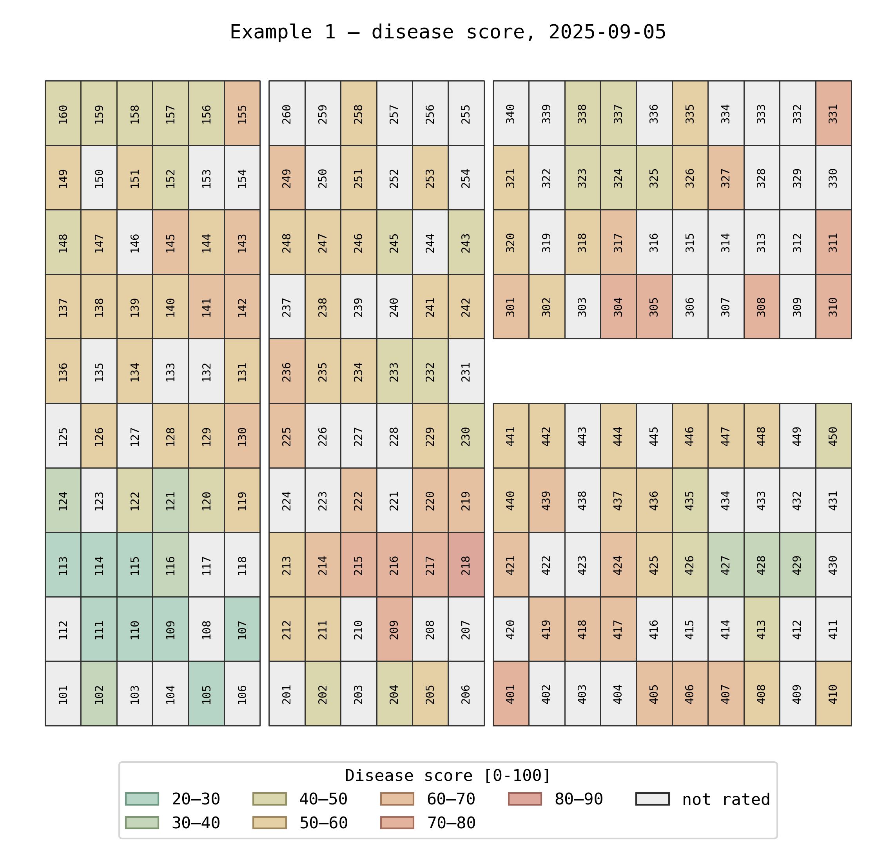
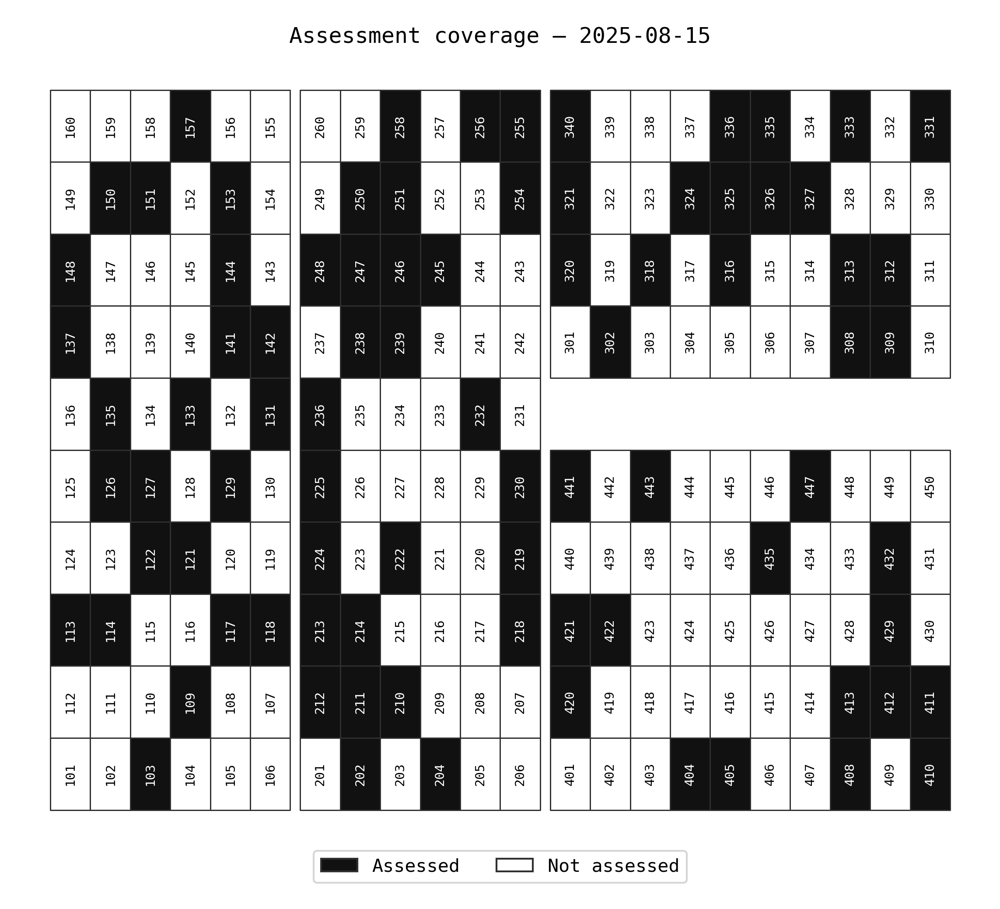
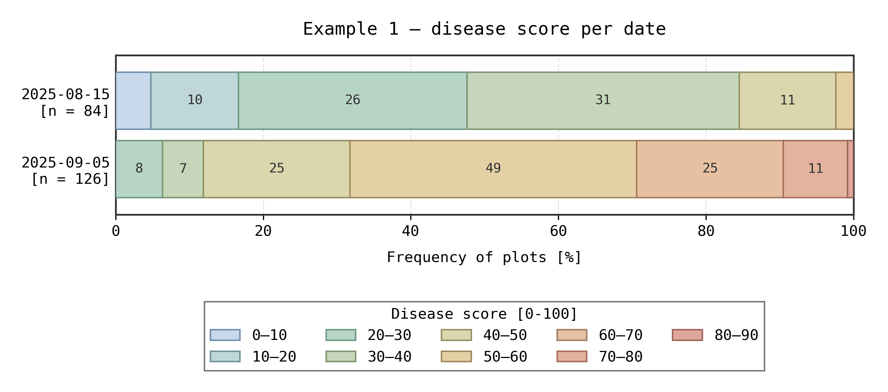
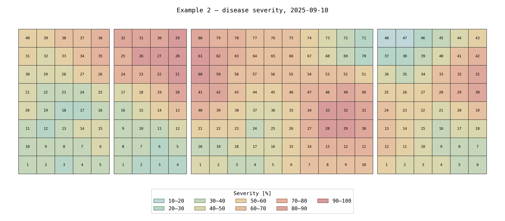

# field_design_extraction

Turns spreadsheet field maps (croquis) and disease rating sheets into two kinds of tables:

- **design** — one row per plot: `plot_key`, `block_id`, `block_label`, `plot_number`, `row`, `column`
  (`row`/`column` are the plot's cell on the map);
- **ratings** — one file per date, only the rated plots: `plot_key`, `block_id`, `plot_number`, `date`,
  `disease` and the value columns you choose (e.g. `score`).

The two join on `plot_key` (`block:plot_number:row:column`; the position keeps it unique when a plot number
occurs twice).

## Install

In the Python environment that will run your scripts (Python 3.10 or newer; matplotlib for the figures):

```
git clone https://github.com/mhdf/field_design_extraction.git
pip install -e field_design_extraction
```

`-e` (editable) makes changes to the package code take effect without reinstalling.

## Use

A project script holds two settings dictionaries and runs the steps:

```python
import field_design_extraction as fde

designs = fde.build_designs(layouts)                    # map → design tables
ratings = fde.build_ratings(rating_sources, designs)    # ratings linked to plots
fde.export(layouts, rating_sources, designs, ratings)   # CSV files
```

Each step prints what it found: plots per block, plot numbers repeated within a block, and per date how many
ratings were linked and why the others were not.

## Examples

Two synthetic examples (made-up plots and scores, 0–100, with spatial patches) in `examples/`:

| example | field map | ratings |
|---|---|---|
| `example_1_merged_plots.py` | 4 blocks, 210 plots, each plot number in a 2-cell merged range | one sheet per date (2 dates), a block column, part of the plots rated |
| `example_2_one_sheet_per_trial.py` | 4 trials side by side, 200 plots numbered from 1 in each trial | one sheet per trial, column names on row 7, MIN/MAX rows below the table |

```
python examples/create_example_workbooks.py        # writes examples/data/*.xlsx (fixed random seed)
python examples/example_1_merged_plots.py          # writes examples/output/example_1/
python examples/example_2_one_sheet_per_trial.py   # writes examples/output/example_2/
```

Example 1 — design, and the scores of the second date (grey: not rated on that date):

 

Example 1 — plots assessed on the first date, and the score classes per date:

 

Example 2 — severity of every plot:



## Settings

### layouts — one entry per field map

| key | meaning |
|---|---|
| `workbook`, `sheet` | the map |
| `region` | Excel range holding the map, e.g. `"B2:AR11"` |
| `output_folder` | where the CSV files go (e.g. `dados/avaliacao_visual/consolidated`) |
| `blocks` | list of `{block_id, label, regions}`; `regions` are the Excel ranges of the block's plots |
| `unit_rules` | which cells count as plots (optional, also per block): `value_types`, `merged` (True/False/None), `anchor` (True: top-left cell of a merged range) |

A cell inside two blocks stops the run with the list of cells. Formula cells are read through the value Excel
saved.

### rating_sources — one entry per ratings workbook

| key | meaning |
|---|---|
| `layout_id` | the layout the ratings belong to |
| `disease`, `workbook` | |
| `assessments` | `{name: {sheet, date}}`; add `block` when each sheet holds one block |
| `header_row` | Excel row with the column names (default 1) |
| `plot_column` | column with the plot number |
| `block_column` | column with the block label; `None` when each sheet holds one block |
| `block_mapping` | block label in the ratings → `block_id` (optional when they are equal) |
| `value_columns` | columns to keep: `{name in the sheet: name in the output}` |

Rows without a plot number (e.g. MIN/MAX rows) are dropped. Ratings that cannot be linked go to
`<source>_<date>_unlinked.csv` with the reason (`link_status`).

### Ratings marked on the map (`"kind": "map"`)

For maps where each date is a copy of the field map and the rating is written into the plot cell (e.g. an
orchard where every cell is a tree). The design then takes every cell as a plot: `unit_rules`
`{"value_types": None, "include_empty": True, "unit_id": "coordinate"}` (plot_number = cell, e.g. `E18`); block
`attributes` (e.g. `{"treatment": "A"}`) become design columns.

| key | meaning |
|---|---|
| `assessments` | `{name: {sheet, date}}`, one sheet per date |
| `status_rules` | ordered list; the first rule whose conditions all hold gives the status. Conditions: `text` (regular expression, case-insensitive), `fills` (list of fill colors as `read_cells` shows them), `empty` (True/False) |
| `default_status` | status of empty cells no rule covers (default `healthy`); non-empty cells no rule covers get `unknown` and are listed |
| `ignore_text` | text read as empty (e.g. plot labels written in tree cells) |
| `flags` | extra True/False columns from the fill, e.g. `{"new_case": ["FFFFFF00"]}` |

Output: one file per date with every plot: `status`, the flags, and the raw cell `value` and `fill`.

### Figures (optional)

```python
fde.save_figures(layouts, rating_sources, designs, ratings, which=["design", "distribution", "maps"])
```

| figure | file | what it shows |
|---|---|---|
| `design` | `<layout_id>.png` | schematic of the plots, colored by block (or any design column, e.g. treatment) |
| `distribution` | `<source>_distribution.png` | share of plots per score class or status, one bar per date; the segments show the number of plots (`segment_labels`: `"count"`, `"percent"` or `None`) |
| `maps` | `<source>_<date>_map.png` | the schematic colored by the rating of that date (grey: not rated) |
| `coverage` | `<source>_<date>_coverage.png` | ratings tables: which plots were assessed on that date |
| `incidence` | `<source>_incidence.png` | map ratings: share of plots with a status per date, one line per group (e.g. treatment) |

Files go to `<output_folder>/figures` (or the layout's `figure_folder`). Options: a `"figure"` entry in a layout
(`title`, `color_by`, `colors`, `names`, `legend_title`, `plot_size`, `rotate`, `show_labels`, `label_rotation`,
`gaps`, `gap_rule`, `block_outlines`, `hatch_shared_with` + `hatch_label`) and in a ratings source (`value`,
`title`, `colors`, `legend_title`, `xlabel`, `map_title`, `coverage_title`, `bins`, `segment_labels`,
`group_others`, `incidence`). Scores with many
values (e.g. % severity) are grouped into classes (`bins`, default 10 units); half scores (1.5, 2.5…) are hatched.

`group_others` (ratings source), e.g. `{"keep": ["healthy", "hlb"], "label": "others", "color": "#8C8C8C"}`:
in the figures, every other class becomes one class whose name lists what it contains, e.g.
`others (gummosis, dead, missing)`, or your own text with `"description": "dead, other diseases, etc."`;
the CSV files keep the detailed values.

Proportions: `plot_size` = (width, height) of each plot on the schematic, in any unit (only the ratio matters).
Make plots wider than tall when rows are farther apart than plots within a row, e.g. the real spacing
`(6.5, 2.5)` in metres; `rotate` turns the whole map by 90°.

Gaps between blocks: `gaps` = (horizontal, vertical) size; `gap_rule` `"any"` (default) puts a gap wherever
blocks meet (at least 2 neighbouring plots), but the gap crosses the whole figure and may cut other blocks;
`"disjoint"` only separates rows/columns that share no block. `label_rotation`: 0 (horizontal) or 90 (vertical).

### Checking the block ranges

`fde.read_cells(workbook, sheet, region)` returns every cell with value, merged range and fill color;
`fde.color_summary(cells)` groups them by color; `fde.plot_cells(cells, design)` draws the map with the plots of
each block marked.

## Tests

```
python -m unittest discover -s tests -t tests
```
